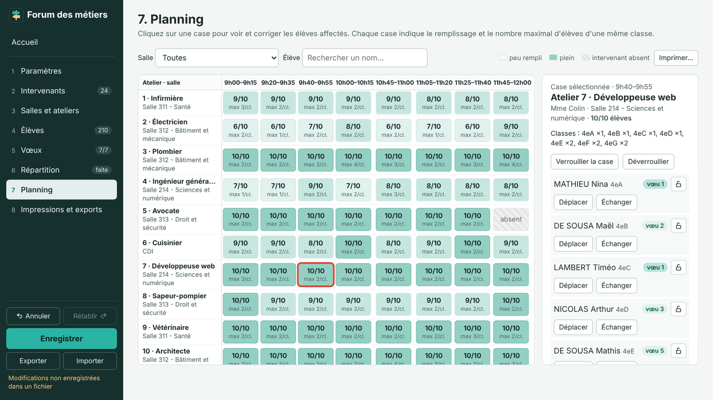
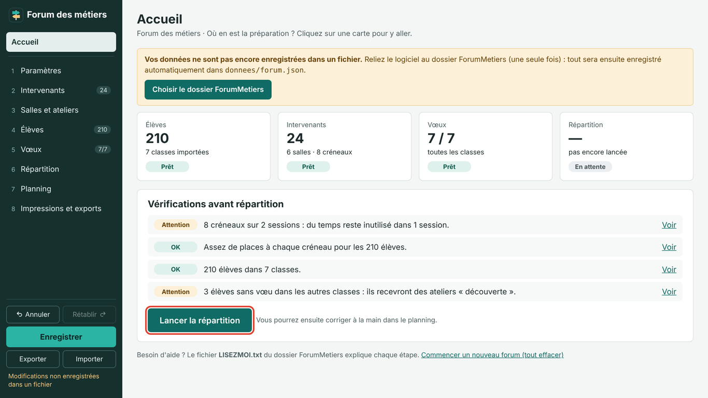
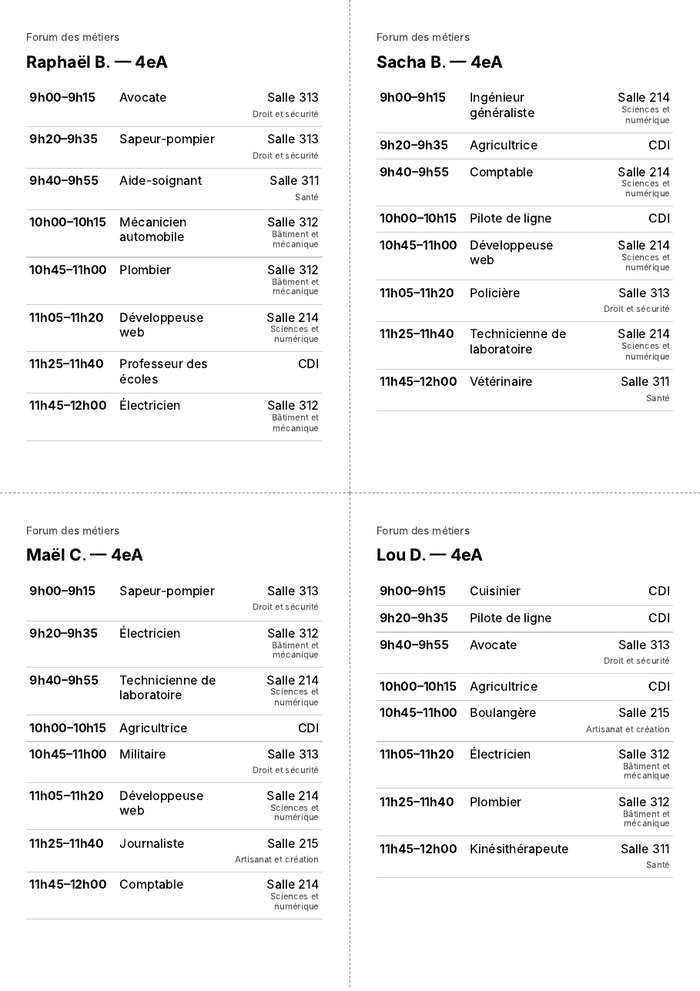

<p align="center"></p>

<h1 align="center">Forum des métiers</h1>

<p align="center">Logiciel portable et hors ligne pour organiser un forum des métiers au collège :<br>
répartition automatique des élèves selon leurs vœux, corrections, convocations et listes d'émargement.</p>

---



## En bref

- **Aucune installation** : un dossier à copier (clé USB, espace de stockage), on double-clique sur `index.html`.
- **Hors ligne** : aucune connexion Internet, aucune donnée envoyée. Tout reste sur l'ordinateur.
- **Compatible** : Windows, Edge, Chrome et Firefox récents, écran 1366 × 768 minimum.
- Conçu pour environ **200 élèves de 4e** (7 classes) et une vingtaine d'intervenants, mais s'adapte à d'autres effectifs.

## Ce que fait le logiciel

| Étape | |
| --- | --- |
| 1. Paramètres | Horaires des sessions, durée des créneaux et du battement, taille des groupes, nombre de vœux. Les créneaux sont calculés automatiquement, avec une suggestion si du temps reste inutilisé. |
| 2. Intervenants | Import depuis Excel (modèle fourni), disponibilités créneau par créneau, contrôle qu'il y a assez de places. |
| 3. Salles | Salles avec un thème facultatif (« 311 - Santé ») et un nombre maximal d'ateliers. |
| 4. Élèves | Import de l'export Pronote (CSV ou Excel), avec choix des colonnes et aperçu. |
| 5. Vœux | Un modèle Excel par classe, avec liste déroulante « 3 - Plombier » ; import avec signalement des erreurs. |
| 6. Répartition | Tirage au sort puis tours en serpentin : chacun reçoit d'abord ses meilleurs vœux, équitablement, en mélangeant les classes. |
| 7. Planning | Grille ateliers × créneaux : un clic sur une case montre ses élèves ; déplacer, échanger, verrouiller. |
| 8. Impressions | Convocations (4 par feuille A4), listes d'émargement par intervenant, planning par classe, classeur Excel récapitulatif. |

Toutes les actions peuvent être annulées (bouton **Annuler** ou Ctrl+Z).

<p>
  
  
</p>

## Télécharger et lancer

1. Cliquez sur le bouton vert **Code**, puis **Download ZIP**.
2. Décompressez le fichier (clic droit → *Extraire tout*).
3. Ouvrez le dossier et double-cliquez sur **`index.html`**.

Pour essayer sans vos fichiers : sur l'accueil, cliquez sur **Charger des données d'exemple** (210 élèves et 24 intervenants fictifs).

📖 Le **[manuel utilisateur illustré](documentation/Manuel_utilisateur_Forum_des_metiers.pdf)** décrit chaque étape. Un résumé se trouve dans [`LISEZMOI.txt`](LISEZMOI.txt).

## Enregistrement des données

- **Edge ou Chrome** : on relie une fois le logiciel au dossier ; tout est ensuite enregistré automatiquement dans `donnees/forum.json`, avec une copie de sauvegarde à chaque séance.
- **Firefox** : boutons **Exporter / Importer** (fichier `.json`).

## Données personnelles

Le logiciel ne conserve que le **nom, le prénom, la classe et les vœux** des élèves. Rien n'est envoyé sur Internet.
Le fichier `.gitignore` empêche de publier par erreur les données réelles (`donnees/forum.json`, sauvegardes, exports) : **ne déposez jamais ces fichiers sur GitHub**. Les fichiers de `donnees/exemple/` sont entièrement fictifs.

## Organisation du dossier

```
ForumMetiers/
├── index.html        ← double-cliquer ici
├── LISEZMOI.txt      ← mode d'emploi résumé
├── documentation/    ← manuel utilisateur (PDF) et captures
├── app/              ← le programme : HTML, CSS, JavaScript (sans bibliothèque externe)
├── donnees/          ← données du forum (non publiées) et fichiers d'exemple
└── exports/          ← fichiers générés (non publiés)
```

Le code est en JavaScript simple, commenté en français, sans outil de compilation : on modifie un fichier dans `app/`, on recharge la page.
Les fichiers Excel sont lus et écrits par `app/js/xlsx.js`, sans bibliothèque externe.

## Licence

Distribué sous licence [MIT](LICENSE) : libre à vous de l'utiliser, de le modifier et de le partager.
